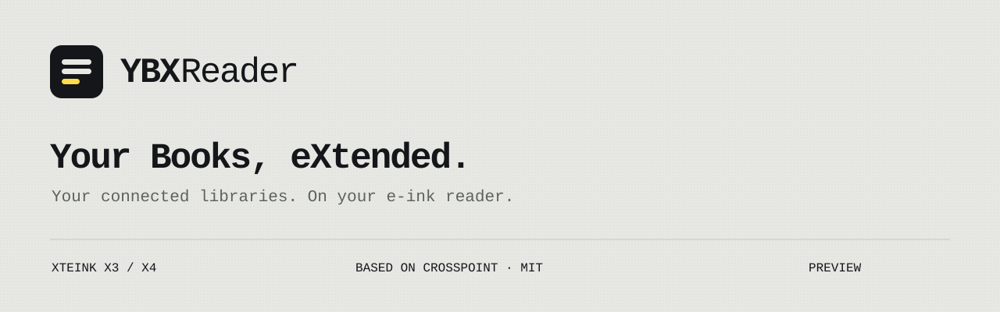

<p align="center">
  <a href="https://ybx.app"></a>
</p>

<p align="center">
  <a href="https://ybx.app">Website</a> ·
  <a href="https://my.ybx.app">YBX account</a> ·
  <a href="YBX_FORK.md">Installation &amp; compatibility</a> ·
  <a href="https://github.com/jhdvp/ybx-crosspoint/releases">Releases</a> ·
  <a href="https://github.com/jhdvp/ybx-crosspoint/issues">Issues</a>
</p>

# YBX Reader

Your connected book libraries on an e-ink reader. YBX Reader is an independent
[CrossPoint Reader](https://github.com/crosspoint-reader/crosspoint-reader) fork
for **Xteink X3 and X4**, with YBX branding and a matching SD-card plugin.
Connect your services in [your YBX account](https://my.ybx.app), then browse
and download available text books on the reader.

> **Development preview.** The firmware builds and host checks pass. Device
> testing and the release blockers below remain open. This repository does not
> yet offer a hardware-verified YBX firmware release.

## One account, your connected libraries

- **Yandex Books, WB Books and LitRes:** the native YBX catalog lists only
  services connected to the current account. LitRes currently exposes purchased
  text books available through the integration.
- **Browse, search, download:** use the reader's catalog screens; downloaded
  EPUBs open in its built-in reader. Library covers come from the EPUB package.
- **YBX on the device:** boot and default sleep branding, web panel, network
  names and About screen. Firmware updates use the YBX release channel.
- **Keep your library:** existing SD settings, reading positions and plugin
  tokens retain their `/.crosspoint/` paths.

Service credentials stay on the YBX server. The reader holds a scoped,
revocable YBX token. Available books depend on the connected account and
provider permissions; this project does not bypass DRM.

## What is ready, and what is still open

| Area | Current status |
| --- | --- |
| YBX branding and dedicated update channel | Implemented; device acceptance pending |
| Connected-service catalog and search | Implemented with authenticated list loading; device acceptance pending |
| X3/X4 firmware build | Passing on upstream `a790b144` with its pinned FreeInk SDK |
| Wi-Fi settings loaded before sleep | Included from upstream; fresh-wake behavior still needs a device test |
| Automatic sleep-card refresh | **Open blocker:** queued events can delay the image request; manual refresh is available |
| Sleep-card design and statistics | Rendered by the YBX server; successful firmware build does not prove automatic delivery |
| Cover thumbnails in the native catalog | Not implemented; EPUB library covers are separate |
| Extended YBX book actions | Planned |
| HTTPS certificate verification | Implemented on this branch (built-in CA bundle, host name check, clock gate, no downgrade redirects); device acceptance pending |

The build passed **918 CTest cases**, including the Python checks and the TLS
policy suite. These results
apply to this preview; they do not establish hardware rendering, battery use,
runtime memory or OTA recovery. See [fork details](YBX_FORK.md) for the limits
and the device acceptance checklist.

## Try the preview

1. Read [installation and compatibility](YBX_FORK.md) and check the
   [release page](https://github.com/jhdvp/ybx-crosspoint/releases). An upstream
   CrossPoint release is a different firmware.
2. Back up the reader's SD card and current firmware. Keep the existing
   `/.crosspoint/` directory, including tokens and reading progress.
3. Build the YBX preview below, or use a YBX release when one is published.
   An OTA application image and a USB factory image are different files;
   follow the instructions supplied with that build.
4. Install the matching plugin with
   `python scripts/install_ybx_plugin.py /path/to/card`.
   It preserves existing token/config files and refuses ambiguous installations.
5. Enable Plugins under Settings → Connectivity, open YBX and follow the pairing
   prompt. Connect services in the YBX account; reopen the catalog after changing
   connections.

The public stock-CrossPoint plugin and the bundled **1.7.0** plugin are separate
channels. This bundled version requires firmware capability `catalog.lists.auth`.
Do not copy it onto a stock firmware that lacks that capability.

## Build from source

Use [pioarduino PlatformIO Core](https://github.com/pioarduino/platformio-core)
and the pinned SDK submodule. The verified toolchain is pioarduino **6.1.19**;
formatting uses `clang-format` **21**.

```sh
git clone --recursive --branch feat/ybx-native-integration https://github.com/jhdvp/ybx-crosspoint.git
cd ybx-crosspoint
CROSSPOINT_RC_HASH="$(git rev-parse --short=7 HEAD)" pio run -e gh_release_rc
```

This command builds without flashing a device. See the
[development documentation](docs/contributing/README.md) for the inherited
firmware tooling and [fork notes](YBX_FORK.md) for YBX-specific behavior.

## Following CrossPoint updates

This fork retains the full CrossPoint Git history and the FreeInk SDK submodule.
We can fetch later `upstream/develop` changes and merge them into the YBX branch,
resolve conflicts, and repeat the build and device checks before releasing.
YBX branding, service integration and the separate update channel remain our
maintenance responsibility. Updates are reviewed and integrated, rather than
automatically replacing YBX firmware with an upstream binary.

## Documentation and credits

- [YBX fork: installation, compatibility and open limits](YBX_FORK.md)
- [Reader user guide](USER_GUIDE.md)
- [SD-card plugin contract](docs/sd-plugins.md)
- [Web interface](docs/webserver.md)
- [Original CrossPoint README](README-UPSTREAM.md)
- [MIT license](LICENSE)

Built on CrossPoint Reader and FreeInk SDK. Their history, license and contributor
credits are retained. The original README is preserved separately, including its
upstream installation instructions and community links.

YBX is an independent project, unaffiliated with Yandex, Bookmate, LitRes, WB Books,
Xteink or the CrossPoint project. YBX service integrations act on behalf of the
authorized user.
