# YBX Reader screen plans

These are the screen designs agreed for the YBX firmware. **They are design
mockups, not screenshots from a running reader.** Books, numbers, awards, time
and battery values are demonstration data. The pairing QR points to the general
pairing page; the displayed code does not link a real device.

The layouts use a **528 × 792** canvas. X4 Pro has a separate **480 × 800** touch
profile; these images do not demonstrate its final layout or hardware support.
Fonts, spacing, navigation and empty/error/offline states are adjusted during
implementation. A matching build still needs device acceptance.

Implementation notes below refer to the [integration preview](https://github.com/jhdvp/ybx-crosspoint/tree/integrate/ybx-reader-review-20261029)
as of 29 October 2026. That branch is separate from a published firmware release.
See the [hardware acceptance checklist](https://github.com/jhdvp/ybx-crosspoint/blob/integrate/ybx-reader-review-20261029/docs/ybx-hardware-acceptance.md).

## Overview

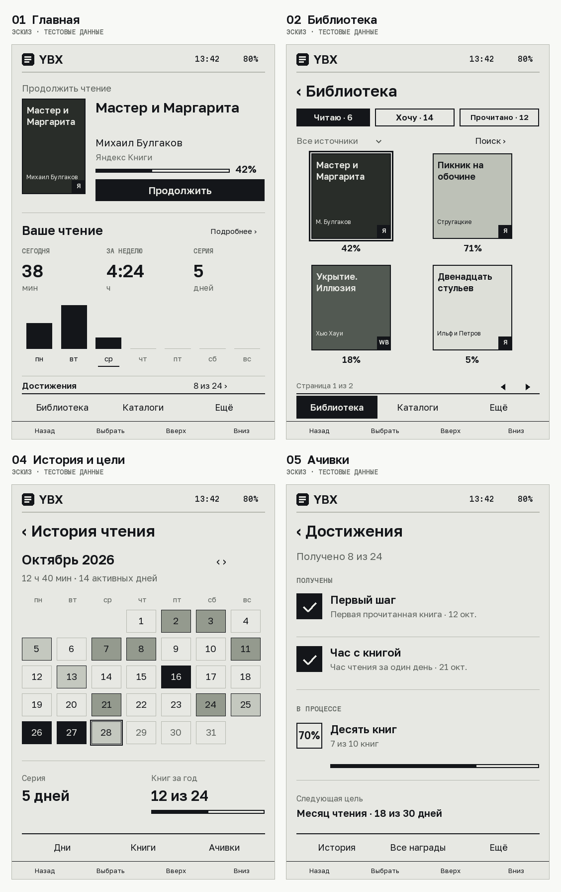

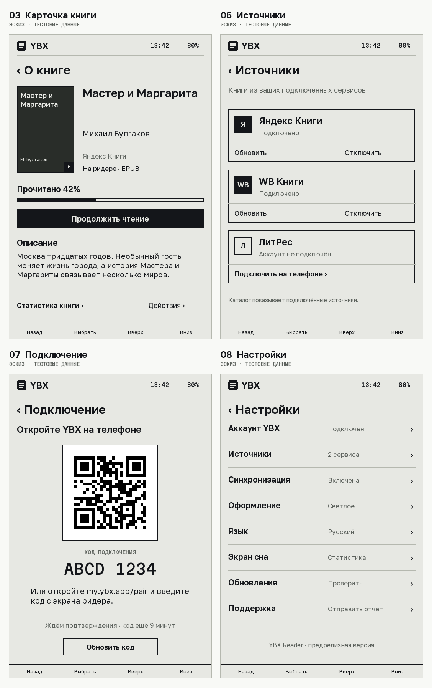

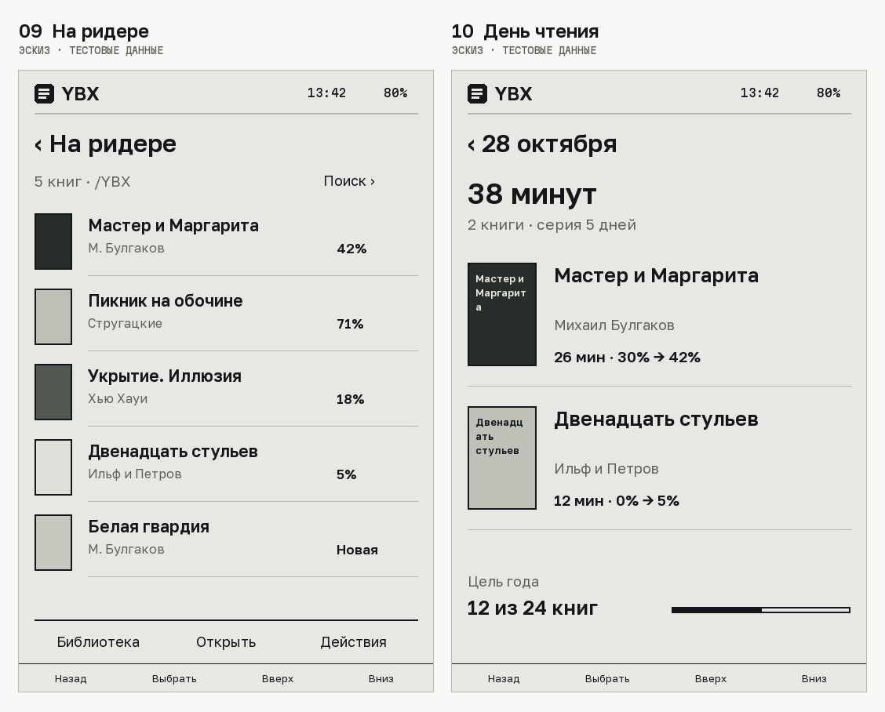

## Individual screens

### Home

Continue reading, a compact account summary and seven-day activity.

**Implementation:** Native account summary implemented on the integration branch; layout remains a design reference.

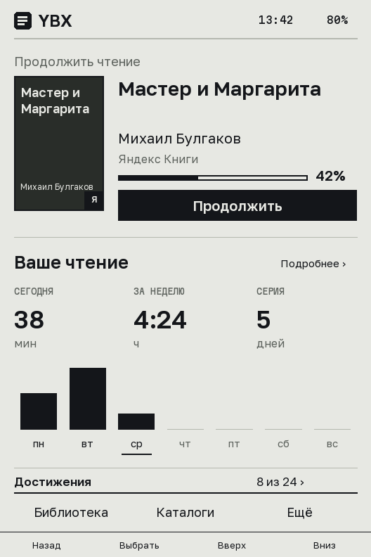

### Library

Shelves, source selection, search, covers and progress.

**Implementation:** Catalog tree and availability handling implemented; the illustrated cover grid remains planned.

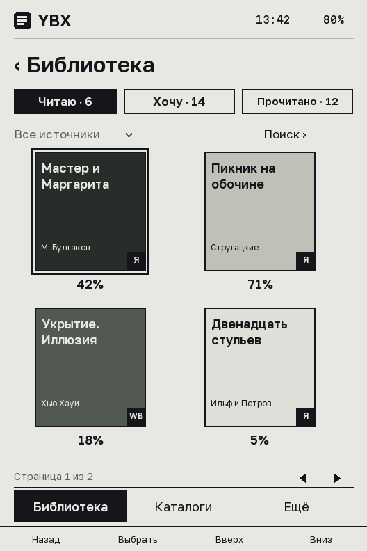

### Book details

Description, reading progress and book actions.

**Implementation:** Native details and local open/remove actions exist; the full illustrated composition remains planned.

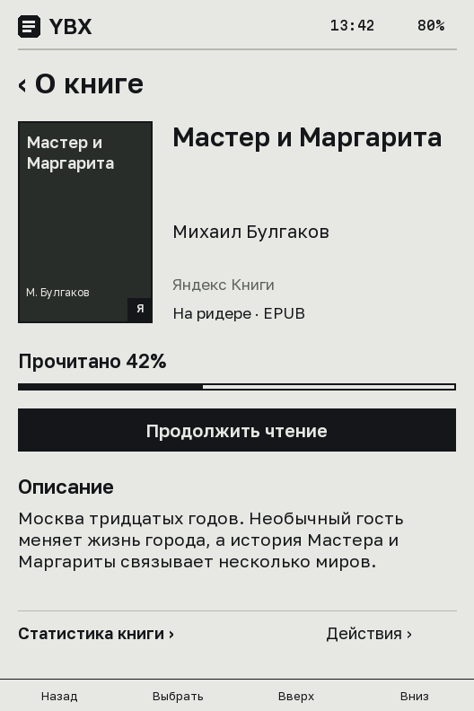

### History and goals

Calendar, reading streak and annual goal.

**Implementation:** Local reading statistics exist; the illustrated calendar and annual-goal screen remain planned.

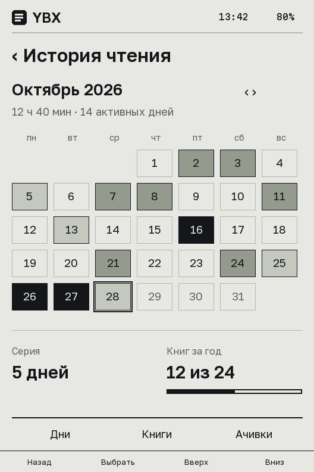

### Achievements

Received awards and awards in progress.

**Implementation:** Native text cards, details and offline paging implemented; illustrated artwork and numeric progress depend on available API data.

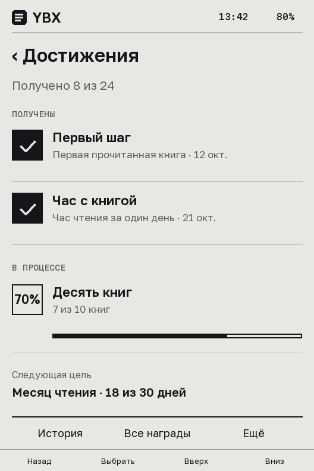

### Sources

Only connected services appear in the catalog.

**Implementation:** Connected-service catalog implemented; the illustrated account-management screen remains planned.

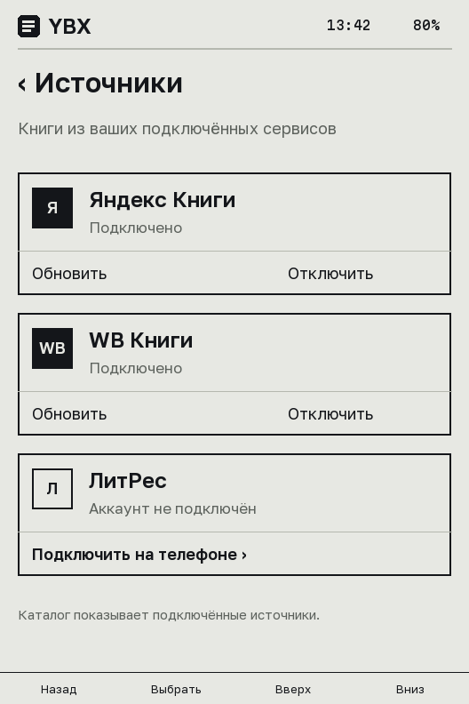

### Pairing

Link the reader from a phone using a code or QR.

**Implementation:** Plugin pairing exists; the illustrated native pairing screen remains planned.

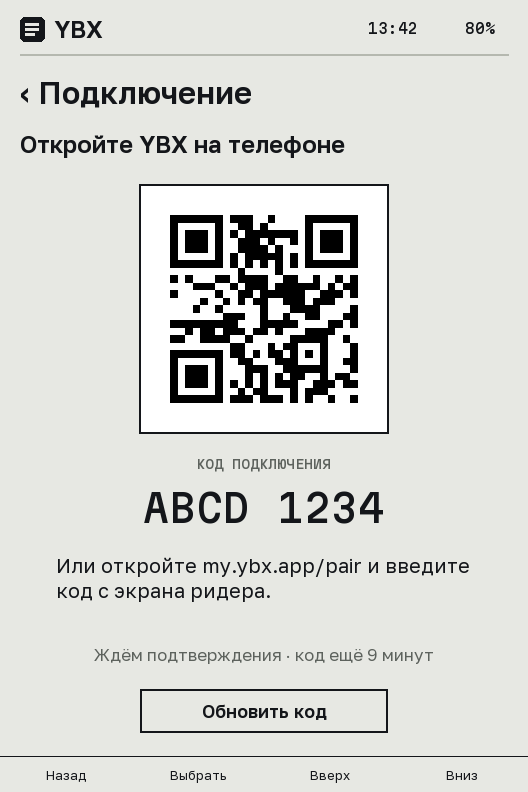

### Settings

Account, sync, appearance, sleep screen and updates.

**Implementation:** Native settings, About and OTA flows exist; this unified composition remains a design reference.

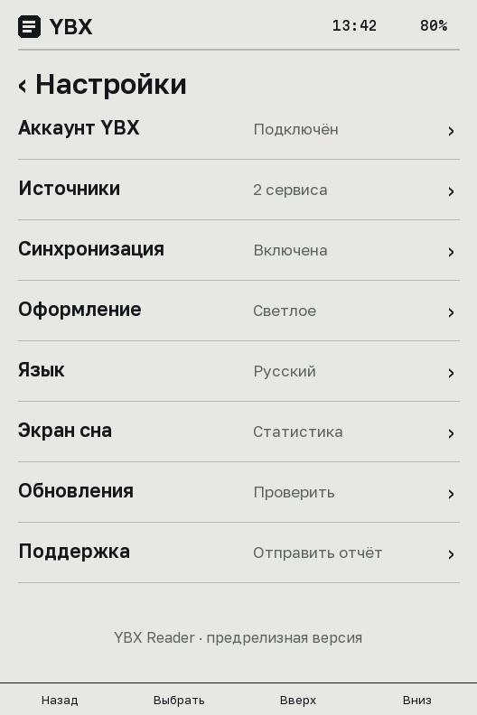

### On Reader

Downloaded books, offline opening and local file actions.

**Implementation:** Shelf and local actions implemented on the integration branch; illustrated card layout remains planned.

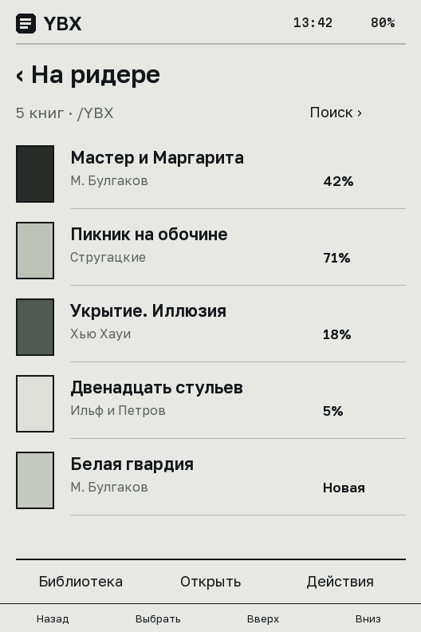

### Reading day

Reading time and progress per book for one day.

**Implementation:** Detailed per-day account view remains planned.

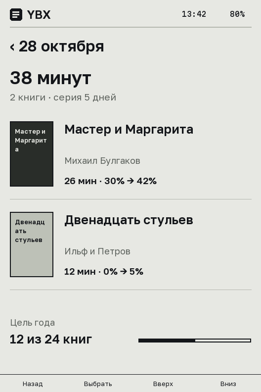

## What the mockups do not cover

The reading engine, contents, bookmarks, dictionary and clipping screens keep
upstream behavior unless a separate implementation says otherwise. These images
do not imply that vCodex is integrated. Award percentages and earned dates must
come from real service data; the examples in the pictures are not API promises.
The sleep card is generated by the YBX server and is a separate screen.
